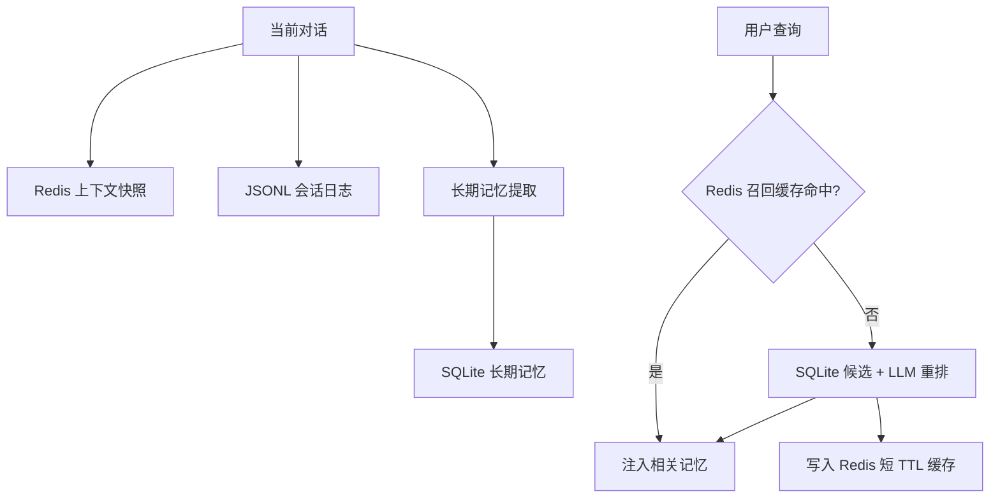

# MewCode 记忆存储架构

## 分层职责

| 层级 | 存储 | 内容 | 是否权威 |
|------|------|------|----------|
| L1 | 进程内 `ConversationManager` | 当前活跃对话 | 否 |
| L2 | Redis | 会话上下文快照、召回结果 | 否，可丢弃 |
| L3 | SQLite | 用户偏好、纠正反馈、项目知识、参考资料 | 是 |
| L4 | JSONL/文件 | 完整会话审计、大型工具输出和附件 | 是 |

Redis 只负责加速。Redis 未安装、连接超时、数据过期或被淘汰时，MewCode 自动读取 SQLite 和 JSONL，功能不应中断。

## 数据流



## Redis 键

键包含项目路径的 SHA-256 短哈希，避免不同项目相互污染：

```text
mewcode:context:<project_hash>:<session_id>
mewcode:recall:<project_hash>:<query_hash>
```

- 上下文快照默认保留 7 天，最多 200 条消息。
- 单个上下文快照上限为 4 MB，超限时跳过缓存并继续使用 JSONL。
- 召回结果默认保留 5 分钟。
- 上下文包含工具调用、工具结果和 thinking block 的结构化数据。
- 会话恢复只使用不早于 JSONL 元数据的 Redis 快照；旧快照会被忽略。
- 同一会话已经注入的记忆不会重复注入。

## 配置

Redis 客户端是可选依赖：

```powershell
uv sync --extra redis
```

项目或用户配置：

```yaml
redis:
  enabled: true
  url: redis://127.0.0.1:6379/0
  key_prefix: mewcode
  context_ttl_seconds: 604800
  recall_ttl_seconds: 300
  max_messages: 200
  socket_timeout_seconds: 0.5
```

使用 `/status` 查看连接状态。`已降级` 表示当前请求会使用 SQLite/JSONL，而不是失败。

## 本机部署

当前 Windows 环境使用 Memurai Developer 4.1.2 提供 Redis 7.2 兼容协议：

```text
程序目录：C:\MewCodeRedis\extracted\SourceDir\Memurai
配置文件：C:\MewCodeRedis\memurai-mewcode.conf
监听地址：127.0.0.1:6379
最大内存：256 MB
淘汰策略：allkeys-lru
自启动任务：MewCodeRedis
```

Memurai Developer 不能用于生产环境，并会在连续运行 10 天后自动停止。开发机重启或重新运行计划任务即可恢复；正式服务端部署应改用官方 Redis 或 Redis Stack。
